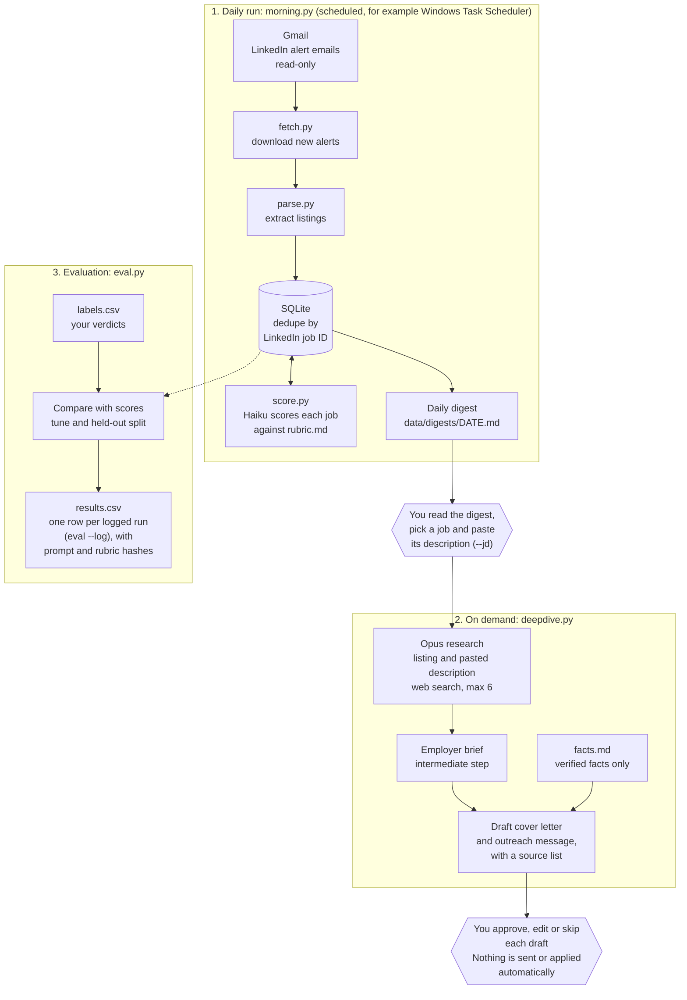

# Job Scout

## What it does

Job Scout reads LinkedIn job-alert emails from Gmail with read-only access, scores each job against a written rubric with a language model, and writes a daily digest you can read. Nothing is ever sent or applied for automatically.

## How it works

The pipeline runs in this order:

1. **Fetch.** `gmail.py` uses the `gmail.readonly` scope only. It lists, reads and fetches headers; it never sends, deletes or modifies email. A saved token with any other scope is refused.
2. **Parse.** `parse.py` turns each alert email into listings (title, company, location, job link). It reads the HTML body first and falls back to plain text. Emails not from LinkedIn's alert senders are skipped. Links are reduced to their LinkedIn job ID and are never followed.
3. **Dedupe.** `db.py` stores listings in SQLite (`data/jobscout.db`) keyed on the job ID, so a job that appears in several emails is stored and scored once. Each sighting is still recorded.
4. **Score.** `score.py` sends only the title, company and location to `claude-haiku-5-5` at low effort, with `rubric.md` as instructions. The model returns a score from 0 to 100, a verdict (shortlist, maybe or skip) and two or three short reasons, validated against a schema. Each score is stored with a hash of the full prompt, so a changed rubric means a re-score.
5. **Digest.** `morning.py` runs fetch and score unattended and writes `data/digests/<date>.md`, listing shortlist and maybe jobs best first. The first line always states whether the run succeeded. It never opens a browser and never sends anything.
6. **Deepdive.** `deepdive.py` is a manual step for one job you choose. You paste the job description into a text file. It researches the employer with web search (job sites and LinkedIn are blocked), then drafts a cover letter and an outreach message using only the facts in `facts.md`. Drafts are checked against those facts before you see them.



**Human approval.** Every deepdive draft is shown to you to approve, edit or skip. Approved and edited drafts are saved to `data/drafts/` for you to send yourself. Skipped drafts are not saved. The tool has no code path that sends email, submits an application or contacts anyone.

## Install and run

Requires Python 3.12 (the version it was built and tested on). The commands below are for Windows PowerShell, which the scheduled run (`run_morning.bat`) and the deepdive editor (Notepad) assume.

```
python -m venv .venv
.venv\Scripts\activate
pip install -r requirements.txt
```

Copy the example files and edit them for your own search:

```
copy rubric.example.md rubric.md
copy facts.example.md facts.md
copy labels.example.csv labels.csv
```

`JOBSCOUT_RUBRIC` and `JOBSCOUT_FACTS` can point to other paths. They must be set in the environment, not in `.env`.

Create `.env` in the repository root with your Anthropic API key:

```
ANTHROPIC_API_KEY=
```

Deepdive also needs `JOBSCOUT_SIGN_NAME` in `.env`, the first name drafts end with.

### Gmail OAuth setup (outline)

1. In Google Cloud, create a project and enable the Gmail API.
2. Configure the OAuth consent screen and add your own account as a test user.
3. Create an OAuth client of type Desktop app, download its JSON and save it as `credentials.json` in the repository root.
4. Run `python jobscout.py auth`. A browser opens; grant read-only access. The token is saved to `token.json`.

`credentials.json`, `token.json` and `.env` are git-ignored. Apps in testing mode expire the sign-in after 7 days; the digest warns from day 5. Run `auth` again to renew.

### Commands

```
python jobscout.py auth                 # read-only Gmail sign-in
python jobscout.py fetch                # read alerts under the "jobscout" Gmail label, save new listings
python jobscout.py fetch --query "..."  # use a Gmail search instead of the label
python jobscout.py parse                # parse saved sample emails offline (fetch --dump N saves them)
python jobscout.py score                # score listings not yet scored with the current rubric
python jobscout.py list                 # print listings ranked by score (--verdict, --limit)
python jobscout.py eval                 # compare verdicts with labels.csv
python jobscout.py deepdive JOB_ID --jd jd.txt
python jobscout.py morning              # unattended fetch, score and digest
```

`eval` options: `--template` adds unlabelled listings to `labels.csv`, `--split` assigns tune and held-out rows with a fixed seed, `--holdout` also shows the held-out result, and `--log NOTE` appends the metrics to `results.csv`. `score`, `list` and `eval` take `--effort low|medium|high`.

To run the digest daily, point Windows Task Scheduler at `run_morning.bat`. Each run appends one line to `data\morning.log`.

Run the tests with:

```
python -m unittest discover -s tests
```

## Demo

A read-only browser view over a database of fictional listings, no Gmail or API key needed:

```
pip install -r requirements-ui.txt
python scripts/make_demo_db.py
streamlit run app.py
```

The first command builds `data/demo.db` (fixed seed, so it is the same every time). The page reads the database named by `JOBSCOUT_DB`, default `data/demo.db`, opens it read-only and never writes to it.

## Evaluation

- On the tuning set (126 jobs), agreement with one person's labels was 76.2% against a 65.1% skip-everything baseline. This number is partly fitted.
- On a held-out set of 40 jobs, run once, agreement was 60.0% (24 of 40) against a 65.0% baseline, statistically indistinguishable from the baseline.
- No job labelled shortlist was scored skip in either set.

Method, full results and caveats are in [EVALUATION.md](EVALUATION.md).

## Cost

TBD

## Limitations and privacy

- The scorer sees only title, company and location. Pay is rarely in alert emails and is not guessed.
- Evaluation used one labeller, one inbox and a small held-out set. Time saved has not been measured.
- Model output varies slightly between runs.
- Only LinkedIn alert emails in the current format are parsed. Emails that fail to parse are logged to `data/jobscout.log` and retried on the next run.
- Gmail access is read-only. Listings, scores, drafts and logs stay in the local `data/` folder. Listing titles, companies and locations, and for deepdive the job description and `facts.md`, are sent to the Anthropic API.

Before publishing, the repository is checked for personal data and secrets with `scripts/scan_history.py`. See [docs/PRIVACY_SCAN.md](docs/PRIVACY_SCAN.md).
