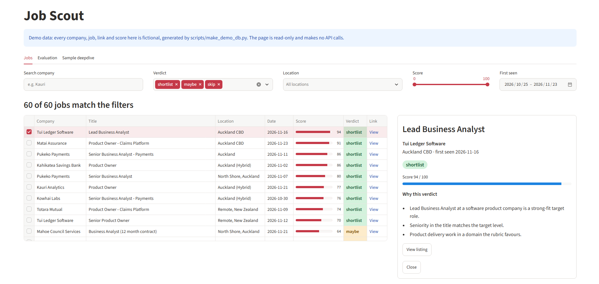
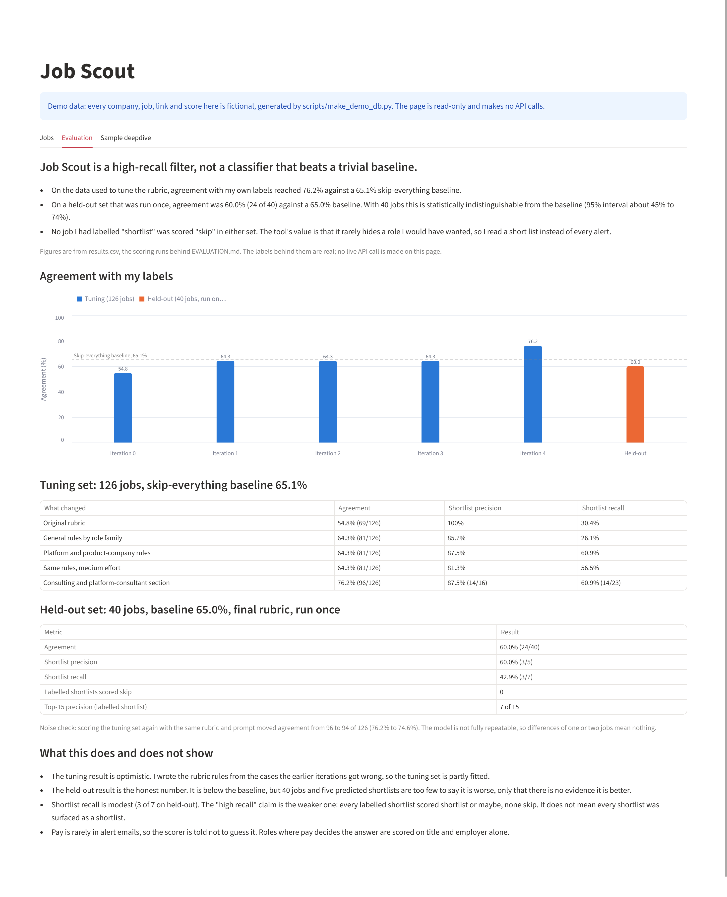
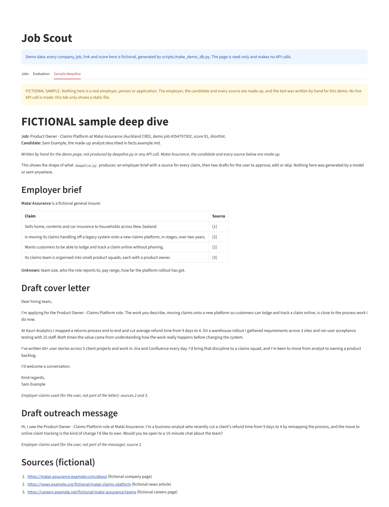
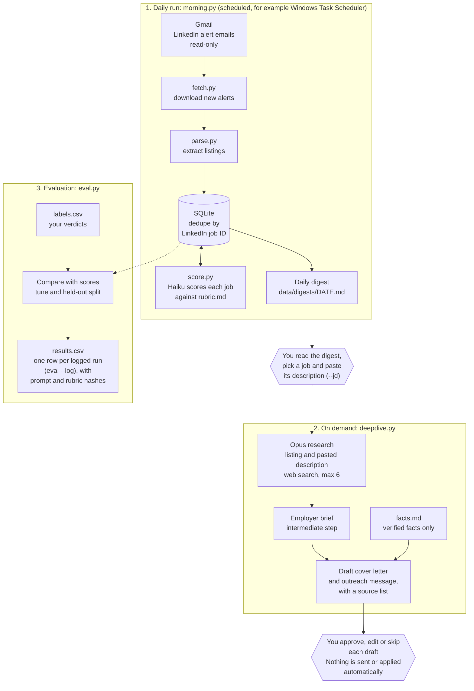

# Job Scout

A personal AI-assisted workflow that triages LinkedIn job-alert emails. It scores each job against a written rubric and writes a daily digest. One step, the employer research behind drafted applications, is agentic. Nothing is ever sent or applied for automatically.

## The problem

LinkedIn job alerts match on the keywords and filters I set, such as title and location. They can't know what makes a role worth my time: the seniority, whether the work is product delivery or pure consulting, the type of employer, or whether it's a contract. So the inbox fills with listings that fit the keywords but not me, and the few that do fit are buried among them.

In my own labelled sample, 108 of 166 alerts (65%) were roles I would skip, and 30 (about 18%) were ones I would shortlist. Reading everything is slow, and skimming is how a good role gets missed.

## What Job Scout does about it

It scores each alert against a written rubric of what I actually want and produces a short daily digest, so I read a short list instead of every email. For the roles I choose, it researches the employer and drafts an application for me to approve, edit or skip. Nothing is sent automatically. It is built to avoid hiding roles I would want, not to be a perfect classifier. The evaluation section shows how well that works and where it doesn't.

## What it looks like



The job list with a selected job and its verdict rationale.



Agreement with my labels against the skip-everything baseline, with the held-out result below it.



A sample deepdive, written by hand to show the output format. It was not generated by the tool, and the employer, candidate and sources are fictional.

All data in these screenshots is fictional. The evaluation figures are from my own labelled jobs.

## Evaluation

Job Scout is a high-recall filter, not a classifier that beats a trivial baseline.

- On the tuning set (126 jobs), agreement with my labels was 76.2% against a 65.1% skip-everything baseline. This number is partly fitted, because I wrote the rubric rules from the cases earlier iterations got wrong.
- On a held-out set of 40 jobs, run once, agreement was 60.0% (24 of 40) against a 65.0% baseline. That is below the baseline, and statistically indistinguishable from it.
- No job I labelled shortlist was scored skip in either set. That is the claim: the tool rarely hides a role I would want. It does not surface every shortlist as a shortlist: on the held-out set, 3 of 7 were scored shortlist and the other 4 maybe.
- The tune/held-out split is stored per row in `labels.csv` and is never reshuffled once assigned; seed 20261106 was used only for the first assignment.

Method, full results and caveats are in [EVALUATION.md](EVALUATION.md).

## How it works

The pipeline runs in this order:

1. **Fetch.** `gmail.py` uses the `gmail.readonly` scope only. It lists, reads and fetches headers; it never sends, deletes or modifies email. A saved token with any other scope is refused.
2. **Parse.** `parse.py` turns each alert email into listings (title, company, location, job link). It reads the HTML body first and falls back to plain text. Emails not from LinkedIn's alert senders are skipped. Links are reduced to their LinkedIn job ID and are never followed.
3. **Dedupe.** `db.py` stores listings in SQLite (`data/jobscout.db`) keyed on the job ID, so a job that appears in several emails is stored and scored once. Each sighting is still recorded.
4. **Score.** `score.py` sends only the title, company and location to `claude-haiku-5-5` at low effort, with `rubric.md` as instructions. The model returns a score from 0 to 100, a verdict (shortlist, maybe or skip) and two or three short reasons, validated against a schema. Each score is stored with a hash of the full prompt, so a changed rubric means a re-score.
5. **Digest.** `morning.py` runs fetch and score unattended and writes `data/digests/<date>.md`, listing shortlist and maybe jobs best first. The first line always states whether the run succeeded. It never opens a browser and never sends anything.
6. **Deepdive.** `deepdive.py` is a manual step for one job you choose. You paste the job description into a text file. It researches the employer with web search (job sites and LinkedIn are blocked), then drafts a cover letter and an outreach message using only the facts in `facts.md`. Drafts are checked against those facts before you see them.



Everything up to the digest is a fixed pipeline: code decides each step, and the model makes one structured call per listing, retried once if the output is invalid. The research step in deepdive is the one agentic part: the model is given a web search tool (up to 6 searches, job sites blocked) and decides what to search for and when to stop. Every search is logged with its query, and with the reason the model gives for it when it gives one; a missing reason is flagged. The rest of deepdive is fixed: a tool-free call turns the research into a brief in which every claim must cite a URL a search returned, a drafting call writes from `facts.md` and the brief, and code checks the drafts before a separate verification call checks them again. A cost estimate is shown and Enter is required before any API call.

**Human approval.** Every deepdive draft is shown to you to approve, edit or skip. Approved and edited drafts are saved to `data/drafts/` for you to send yourself. Skipped drafts are not saved. The tool has no code path that sends email, submits an application or contacts anyone.

## Install and run

Requires Python 3.12 (the version it was built and tested on). The commands below are for Windows PowerShell, which the scheduled run (`run_morning.bat`) and the deepdive editor (Notepad) assume.

```
python -m venv .venv
.venv\Scripts\activate
.venv\Scripts\python.exe -m pip install -r requirements.txt
.venv\Scripts\python.exe -m pip install -r requirements-ui.txt    # for the demo
.venv\Scripts\python.exe -m pip install -r requirements-dev.txt   # for the tests
.venv\Scripts\python.exe scripts\make_demo_db.py                  # build the demo database
.venv\Scripts\streamlit.exe run app.py                            # run the demo app
.venv\Scripts\python.exe -m pytest -q                             # run the tests
```

On Windows, if `python` opens the Windows Store app instead of running, use `py -3.12` instead (for example `py -3.12 -m venv .venv`).

Copy the example files and edit them for your own search:

```
copy rubric.example.md rubric.md
copy facts.example.md facts.md
copy labels.example.csv labels.csv
```

Optionally copy `blocked_names.example.txt` to `blocked_names.txt`: client names that drafts must never mention.

`JOBSCOUT_RUBRIC` and `JOBSCOUT_FACTS` can point to other paths. They must be set in the environment, not in `.env`.

Create `.env` in the repository root with your Anthropic API key:

```
ANTHROPIC_API_KEY=
```

Deepdive also needs `JOBSCOUT_SIGN_NAME` in `.env`, the first name drafts end with.

### Gmail OAuth setup (outline)

1. In Google Cloud, create a project and enable the Gmail API.
2. Configure the OAuth consent screen and add your own account as a test user. Add only the `gmail.readonly` scope.
3. Create an OAuth client of type Desktop app, download its JSON and save it as `credentials.json` in the repository root.
4. Run `python jobscout.py auth`. A browser opens; grant read-only access. The token is saved to `token.json`.

In Gmail, create a filter that applies the label jobscout to LinkedIn job-alert emails, or use fetch --query.

`credentials.json`, `token.json` and `.env` are git-ignored. Apps in testing mode expire the sign-in after 7 days; the digest warns from day 5. Run `auth` again to renew.

### Commands

```
python jobscout.py auth                 # read-only Gmail sign-in
python jobscout.py fetch                # read alerts under the "jobscout" Gmail label, save new listings
python jobscout.py fetch --query "..."  # use a Gmail search instead of the label
python jobscout.py parse                # parse saved sample emails offline (fetch --dump N saves them)
python jobscout.py score                # score listings not yet scored with the current rubric
python jobscout.py list                 # print listings ranked by score (--verdict, --limit)
python jobscout.py eval                 # compare verdicts with labels.csv
python jobscout.py deepdive JOB_ID --jd jd.txt
python jobscout.py morning              # unattended fetch, score and digest
```

`eval` options: `--template` adds unlabelled listings to `labels.csv`, `--split` assigns tune and held-out rows with a fixed seed, `--holdout` also shows the held-out result, and `--log NOTE` appends the metrics to `results.csv`. `score`, `list` and `eval` take `--effort low|medium|high`.

To run the digest daily, point Windows Task Scheduler at `run_morning.bat`. Each run appends one line to `data\morning.log`.

## Demo

A read-only browser view over a database of fictional listings, no Gmail or API key needed. To install, build and run it, see the commands in [Install and run](#install-and-run).

`scripts/make_demo_db.py` builds `data/demo.db` (fixed seed, so it is the same every time). The page reads the database named by `JOBSCOUT_DB`, default `data/demo.db`, opens it read-only and never writes to it.

## Cost

One deepdive run (Opus, 6 web searches, early November 2026) used 185,425 input and 11,277 output tokens, which cost about 1.03 USD at list prices. Figures were checked against the Anthropic console usage page on 23 Nov 2026. Scoring uses Haiku with a cached prompt. The total API spend on the account for November, as of 23 Nov, was about 1.16 USD, so scoring and all evaluation runs together cost a small fraction of one deepdive. Prices and usage will differ for you.

## Limitations and privacy

- The scorer sees only title, company and location. Pay is rarely in alert emails and is not guessed.
- Evaluation used one labeller, one inbox and a small held-out set. Time saved has not been measured.
- Model output varies slightly between runs.
- Only LinkedIn alert emails in the current format are parsed. Emails that fail to parse are logged to `data/jobscout.log` and retried on the next run.
- Gmail access is read-only. Listings, scores, drafts and logs stay in the local `data/` folder. Listing titles, companies and locations, and for deepdive the job description and `facts.md`, are sent to the Anthropic API.
- deepdive has been run once, on a real posting, and both drafts were skipped at review. Whether its drafts are useful is untested.

Before publishing, the repository is checked for personal data and secrets with `scripts/scan_history.py`. See [docs/PRIVACY_SCAN.md](docs/PRIVACY_SCAN.md).
